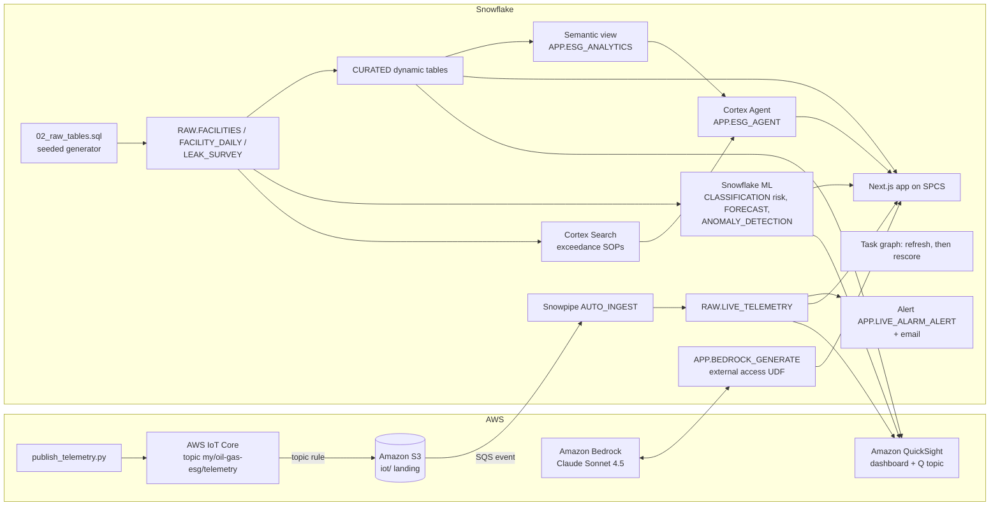

# Malaysia Oil and Gas ESG Monitoring - Facilities and Terminals

ESG monitoring for **30 facilities of a fictional oil and gas operator across 4 Malaysian cities** (Bintulu, Kuantan, Miri, Kota Kinabalu) using Snowflake, optionally with AWS: from a live effluent oil-in-water alarm to a 7-day exceedance-risk score, an alarm email and an AI action memo. The operator, its facilities and all data are synthetic; nothing here describes the environmental performance of any real company or site.

## Architecture

An ESG monitoring pipeline built on **Snowflake** (Dynamic Tables, Snowflake ML, Cortex Search, Cortex Agent, Cortex AI_COMPLETE, SPCS) and, in the full build, **AWS** (IoT Core, S3, Bedrock Claude, QuickSight + Amazon Q). Facility effluent and flare telemetry lands in `RAW.LIVE_TELEMETRY`. Dynamic tables curate 90 days of facility-day history: effluent samples within an internal demo threshold, environmental exceedances, CO2e emissions and emissions intensity, community grievances, effluent treatment uptime and methane leak survey closure. Snowflake ML scores 7-day exceedance risk per facility, forecasts operator-wide daily emissions and flags effluent oil-in-water anomalies. A Cortex Agent answers questions with SOP citations, and an LLM drafts the ESG action memo.

Interactive diagrams (hover for object names): [Snowflake only](docs/architecture-snowflake.html) | [AWS + Snowflake](docs/architecture-aws.html). The app shows both on its Architecture & Data tab, the current build first. Regenerate them with `python3 docs/build_architecture.py`.



The Snowflake-only build drops the AWS subgraph: `APP.SIMULATE_TELEMETRY` writes to `RAW.LIVE_TELEMETRY`, and the app calls Cortex `AI_COMPLETE` instead of the Bedrock UDF.

## Snowflake Capabilities

| Capability | Implementation |
|-----------|---------------|
| Dynamic Tables | `CURATED.KPI_SUMMARY`, `PERFORMANCE_SUMMARY`, `EXCEEDANCE_CAUSES`, `TREND_ANALYSIS` from the RAW tables |
| Snowflake ML | CLASSIFICATION 7-day exceedance risk (`ML.EXCEEDANCE_RISK_SCORES`), 14-day CO2e emissions FORECAST, effluent oil-in-water ANOMALY_DETECTION |
| Cortex Search | 20 synthetic exceedance-response SOPs (one per facility type and cause) in `SEARCH.ESG_SOP_SEARCH` |
| Semantic View | `APP.ESG_ANALYTICS` over facilities, exceedance causes, daily totals and risk |
| Cortex Agent | `APP.ESG_AGENT`: Cortex Analyst over the semantic view plus Cortex Search for SOP citations |
| Cortex AI | `AI_COMPLETE('claude-sonnet-4-5')` for grounded answers, and for the action memo in the Snowflake-only build |
| Alerts + Tasks | `APP.LIVE_ALARM_ALERT` logs ALARM readings and sends email; task graph `TASK_REFRESH_CURATED`, then `TASK_RESCORE_RISK` |
| Snowpark Container Services | Next.js app `APP.MY_OIL_GAS_ESG_APP` with 6 tabs: Executive Cockpit, Predictive, Facility Health, Live IoT, Ask AI, Architecture & Data |
| Snowpipe | `RAW.LIVE_TELEMETRY_PIPE` AUTO_INGEST from S3 (AWS build only) |

## AWS Services

Used only in the AWS + Snowflake build.

| Service | Role in Demo |
|---------|-------------|
| AWS IoT Core | Receives simulated facility telemetry (effluent oil-in-water, flare load). A topic rule writes each message to S3 |
| Amazon S3 | Landing bucket. An event notification goes to the Snowpipe SQS queue |
| Amazon Bedrock | Claude Sonnet 4.5 writes the action memo, called from Snowflake through an external-access UDF |
| Amazon QuickSight | DIRECT_QUERY executive dashboard over Snowflake (daily effluent within threshold, exceedances by facility, exceedance risk) |
| Amazon Q | Natural-language questions over the QuickSight topic `my-oil-gas-esg-topic` |
| AWS IAM | Least-privilege roles for S3, IoT and Bedrock |

## Personas

These personas are fictional.

| Persona | Role | Key Questions |
|---------|------|---------------|
| **Nurul Aisyah Rahim** | VP Sustainability and ESG | "Which region has the lowest share of effluent samples within threshold?" "Which exceedance causes put the most samples over the threshold?" |
| **Hafiz Kamarudin** | Facility Environmental Engineer | "Which facilities are high exceedance risk this week, and which SOP applies?" |

## Data

All data is synthetic and seeded, so every rebuild reproduces it. The operator and facility names are fictional; the four cities are real Malaysian places used only as region labels. Thresholds are internal demo thresholds, not regulatory limits, and no figure is a compliance finding.

| Table | Rows | Description |
|-------|------|-------------|
| RAW.FACILITIES | 30 | Facilities across 4 regions and 5 facility types (Offshore Platform, Gas Processing Plant, Refinery, LNG Terminal, Oil Terminal) |
| RAW.FACILITY_DAILY | 2,700 | Daily facility observations over 90 days: effluent samples and samples within threshold, tonnes processed, t CO2e, grievances, exceedances, root cause, control inspections, treatment downtime, oil-in-water and flare load |
| RAW.LEAK_SURVEY | 30 | Methane leaks found in the latest survey, leaks closed and leaks scheduled per facility |
| SEARCH.ESG_SOP_DOCS | 20 | Synthetic exceedance-response SOPs indexed for Cortex Search |
| RAW.LIVE_TELEMETRY | Grows during the demo | Live readings from IoT Core (AWS build) or `APP.SIMULATE_TELEMETRY` (Snowflake-only build) |
| ML.EXCEEDANCE_RISK_SCORES | 30 | 7-day exceedance probability and risk band per facility |

## Build Instructions

### Prerequisites
- Snowflake account with ACCOUNTADMIN access, and Cortex AI enabled (AI_COMPLETE, Search, Agent).
- An X-Small warehouse with auto-suspend at or below 120 s, and an existing SPCS compute pool.
- Python 3.11+, `snowflake-connector-python`, Node.js 22+, Docker and the `snow` CLI.
- App image: run `snow spcs image-registry login`, then build and push `my-oil-gas-esg-app:v1` to the database's `APP.IMAGES` repository (see the header of `snowflake/07_deploy_app.sql`).
- AWS build only: `boto3`, AWS credentials for the target account (us-west-2) with Bedrock access, and QuickSight Enterprise.

### SPCS App
```
<DATABASE>.APP.MY_OIL_GAS_ESG_APP
```

### Tests
```bash
python -m pytest aws snowflake quicksight
```

For a local run, put `SNOWFLAKE_ACCOUNT`, `SNOWFLAKE_USER`, `SNOWFLAKE_DATABASE`, `SNOWFLAKE_WAREHOUSE`, `SNOWFLAKE_AUTHENTICATOR=PROGRAMMATIC_ACCESS_TOKEN`, `SNOWFLAKE_TOKEN` and `DEMO_PLATFORM` in the environment, then run `npm --prefix app run build && npm --prefix app start`.

## Build Modes

Both modes share the same core. They differ in three places, and the app's `DEMO_PLATFORM` setting (in its SPCS spec) switches the memo provider and the Live IoT tab.

| Layer | Snowflake Only | Full AWS + Snowflake |
|---|---|---|
| Live telemetry | `CALL APP.SIMULATE_TELEMETRY(n)` inserts simulated readings into `RAW.LIVE_TELEMETRY`. This simulates a sensor feed; it is not Snowpipe Streaming | `aws/publish_telemetry.py` to AWS IoT Core, then S3, SQS and Snowpipe AUTO_INGEST |
| Action memo | Cortex `AI_COMPLETE('claude-sonnet-4-5')` | Amazon Bedrock Claude Sonnet 4.5 through `APP.BEDROCK_GENERATE` |
| BI and natural-language questions | The SPCS app is the dashboard; questions go to the Cortex Agent | Also a QuickSight dashboard and an Amazon Q topic |
| App setting | `DEMO_PLATFORM: snowflake` | `DEMO_PLATFORM: aws` |

### Snowflake Only

```bash
# 1. Core data and dynamic tables (guarded: new isolated database only)
python snowflake/run_core.py --database MALAYSIA_OIL_GAS_ESG_SNOWFLAKE --warehouse <XS_WAREHOUSE> --connection <CONNECTION> --apply
# 2. Native telemetry, ML, search, semantic view, agent, alert and task graph
python snowflake/run_intelligence.py --database MALAYSIA_OIL_GAS_ESG_SNOWFLAKE --platform snowflake --warehouse <XS_WAREHOUSE> --connection <CONNECTION> --alert-email you@example.com
# 3. App on SPCS with DEMO_PLATFORM=snowflake (push the image first)
python snowflake/run_intelligence.py --database MALAYSIA_OIL_GAS_ESG_SNOWFLAKE --platform snowflake --warehouse <XS_WAREHOUSE> --connection <CONNECTION> --alert-email you@example.com --files 07_deploy_app.sql --compute-pool <COMPUTE_POOL>
```

During the demo:
- Run `CALL APP.SIMULATE_TELEMETRY(20)` to add live readings. For a continuous feed, run `ALTER TASK APP.TASK_SIMULATE_TELEMETRY RESUME`, and `SUSPEND` it afterwards.
- Run `EXECUTE ALERT APP.LIVE_ALARM_ALERT` to raise the alarm email.
- Run `EXECUTE TASK APP.TASK_REFRESH_CURATED` to refresh the curated tables and rescore risk.

Afterwards, drop the database or run `ALTER SERVICE APP.MY_OIL_GAS_ESG_APP SUSPEND`.

### Full AWS + Snowflake

```bash
# 1. Core data and dynamic tables (guarded: new isolated database only)
python snowflake/run_core.py --database MALAYSIA_OIL_GAS_ESG_AWS --warehouse <XS_WAREHOUSE> --connection <CONNECTION> --apply
# 2. AWS ingestion and Bedrock (dry run first, then --apply)
python aws/setup_aws.py --database MALAYSIA_OIL_GAS_ESG_AWS --account <AWS_ACCOUNT_ID> --connection <CONNECTION> --apply
# 3. ML, search, semantic view, agent, alert and task graph
python snowflake/run_intelligence.py --database MALAYSIA_OIL_GAS_ESG_AWS --platform aws --warehouse <XS_WAREHOUSE> --connection <CONNECTION> --alert-email you@example.com
# 4. App on SPCS with DEMO_PLATFORM=aws (push the image first)
python snowflake/run_intelligence.py --database MALAYSIA_OIL_GAS_ESG_AWS --platform aws --warehouse <XS_WAREHOUSE> --connection <CONNECTION> --alert-email you@example.com --files 07_deploy_app.sql --compute-pool <COMPUTE_POOL>
# 5. QuickSight dashboard and Q topic (needs an existing Snowflake data source)
python quicksight/build_dashboards.py --database MALAYSIA_OIL_GAS_ESG_AWS --account <AWS_ACCOUNT_ID> --principal-arn <QUICKSIGHT_USER_ARN> --data-source-arn <DATA_SOURCE_ARN> --prefix my-oil-gas-esg --apply --update --with-topic
```

QuickSight objects must be shared with the QuickSight user who signs in (`--principal-arn`); otherwise the console shows nothing.

During the demo:
- Run `python aws/publish_telemetry.py --count 20` to send live readings.
- Run `EXECUTE ALERT APP.LIVE_ALARM_ALERT` to raise the alarm email.
- Run `EXECUTE TASK APP.TASK_REFRESH_CURATED` to refresh the curated tables and rescore risk.

Afterwards, `python aws/teardown_aws.py --database MALAYSIA_OIL_GAS_ESG_AWS --account <AWS_ACCOUNT_ID> --connection <CONNECTION> --apply` removes the AWS resources and the account-level Bedrock external-access and S3 storage integrations. It leaves the email integration `MY_OIL_GAS_ESG_EMAIL_INT`, which the Snowflake-only build also uses.

## Business Impact

Industry research and a Snowflake customer story:
- **Methane is a major near-term warming lever**: "Methane is responsible for around 30% of the rise in global temperatures since the Industrial Revolution" -- [IEA, Global Methane Tracker 2024](https://www.iea.org/reports/global-methane-tracker-2024)
- **Oil and gas are a large share of methane emissions**: "The energy sector – including oil, natural gas, coal and bioenergy – accounts for over a third of methane emissions from human activity." -- [IEA, Global Methane Tracker 2024](https://www.iea.org/reports/global-methane-tracker-2024)
- **Uniper** (Snowflake customer, energy): "Resilience is really important. Before, huge data sets could bring us to a halt, but with Snowflake we haven’t had noticeable downtime." -- [Snowflake customer story: Uniper](https://www.snowflake.com/en/customers/all-customers/case-study/uniper/)

## Key Demo Numbers

These figures are synthetic and come from the seeded demo data. Forecast and anomaly figures can shift slightly with the build day.

- **30 facilities**, 2,700 facility-days over 90 days, across 4 regions and 5 facility types; **20,939,769 tonnes** of hydrocarbons processed and **48,558 effluent samples**
- **Effluent within threshold 88.2%**; per-facility values range from 83.9% to 91.2%, and Kota Kinabalu is the lowest region at 87.2%
- **353 environmental exceedances** across 13 root causes; boil-off gas flaring puts the most samples over the threshold
- **Emissions intensity 166.7 kg CO2e/t** (3,490,739 t CO2e in total); LNG terminals are highest at 313.7 kg CO2e/t
- **Exceedance-risk model** out-of-time holdout: precision 0.60, recall 0.705 at a 0.5 threshold, against a 0.44 base rate. 16 facilities are high risk; the top facility is FC-0014, at 98.2%
- **14-day CO2e emissions forecast** with prediction intervals; **18 of 480** facility-days flagged as effluent oil-in-water anomalies
- **Effluent treatment uptime 98.0%**, methane leaks closed 74.7%, 87 community grievances
- **20 SOPs** indexed for Cortex Search and cited by ID in agent answers

## License

Apache 2.0 — See [LICENSE](LICENSE) for details.

This is a personal demo project and is not an official Snowflake offering. It comes with no support or warranty. The operator, facilities and figures are synthetic and do not describe any real company or site. Industry statements cited are from publicly available third-party sources; they are context, not guarantees of results.
